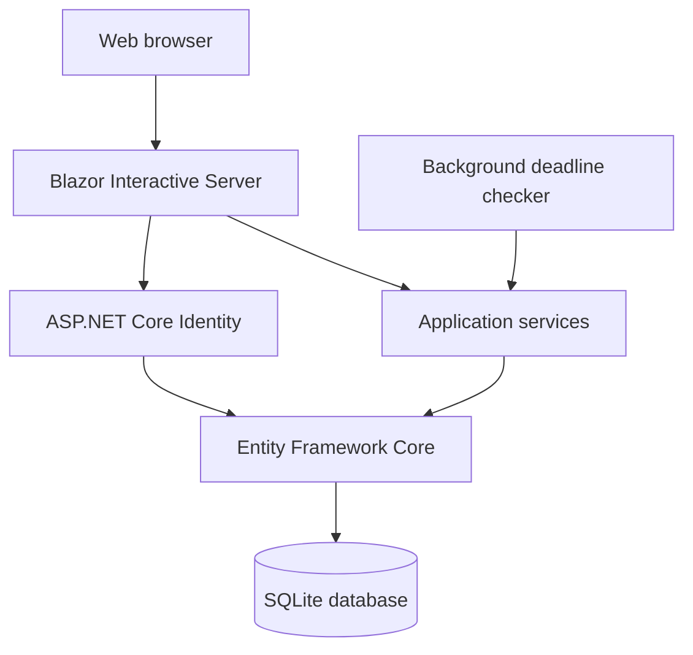

# Quiz Studio
### Online Quiz System

**A role-based quiz platform for creating, taking, and analyzing online assessments.**

Built with C#, ASP.NET Core, Blazor Interactive Server, Entity Framework Core, and SQLite.

## Overview

**Quiz Studio** is a full-stack educational web application designed for three types of users: **Students**, **Teachers**, and **Administrators**. Teachers can build and publish assessments, students can complete timed quizzes and review their progress, and administrators can oversee the complete system.

The application runs locally without a separately installed database server, paid services, API keys, or cloud dependencies. Database migrations and development demo data are initialized during startup.

> **Project scope:** This is a university/educational application, not a production-ready multi-server service. See [Known Limitations](#known-limitations) before deployment.

## Table of Contents

- [Key Features](#key-features)
- [Technology Stack](#technology-stack)
- [Getting Started](#getting-started)
- [Demo Accounts](#demo-accounts)
- [How It Works](#how-it-works)
- [Architecture](#architecture)
- [Project Structure](#project-structure)
- [Database and Data Management](#database-and-data-management)
- [Testing](#testing)
- [Database Migrations](#database-migrations)
- [Security Notes](#security-notes)
- [Known Limitations](#known-limitations)
- [Academic Submission](#academic-submission)
- [References](#references)

## Key Features

| Area | Capabilities |
| --- | --- |
| **Authentication** | Account registration, sign-in/sign-out, password hashing, roles, login lockout, and rate limiting |
| **Quiz management** | Create, edit, publish, and archive quizzes; configure time limits and passing scores |
| **Question types** | Four answer options, single-answer and multiple-answer questions, topics, explanations |
| **Quiz experience** | Server-side countdown, question navigation, autosaving, resume after reload, deadline-based submission |
| **Evaluation** | Automatic grading, answer review, explanations, and pass/fail calculation |
| **Student analytics** | Attempt history, retakes, leaderboard, topic analysis, and recent-results chart |
| **Teacher analytics** | Insights for owned quizzes and downloadable CSV results |
| **Administration** | Manage all quizzes and view platform-wide statistics |
| **User interface** | Responsive layouts, light/dark themes, saved theme preference, catalog search and filters |
| **Data integrity** | Snapshot of each attempt's questions, ownership checks, duplicate-submission protection |

### Role-based access

| Capability | Student | Teacher | Admin |
| --- | :---: | :---: | :---: |
| Browse published quizzes | ✓ | — | — |
| Take quizzes and review attempts | ✓ | — | — |
| View leaderboard and progress | ✓ | — | — |
| Create and edit own quizzes | — | ✓ | ✓ |
| Review results for own quizzes | — | ✓ | ✓ |
| Manage all quizzes | — | — | ✓ |
| View global statistics | — | — | ✓ |

Newly registered users receive the **Student** role. A user cannot select a privileged role during registration.

## Technology Stack

| Layer | Technology |
| --- | --- |
| Language | C# |
| Runtime | .NET 10 |
| Backend | ASP.NET Core |
| UI | Blazor Interactive Server |
| Data access | Entity Framework Core |
| Database | SQLite |
| Authentication and authorization | ASP.NET Core Identity |
| Unit/integration/UI tests | xUnit and project-provided test components |
| End-to-end browser tests | Playwright |
| Frontend styling | Local CSS and JavaScript |

## Getting Started

### Prerequisites

- **.NET 10 SDK** (version `10.0.100` or later in the 10.0 series): [Install .NET](https://dotnet.microsoft.com/en-us/download/dotnet/10.0)
- Windows, macOS, or Linux
- An internet connection on the **first** run to restore NuGet packages
- Optional: Visual Studio 2026 with the **ASP.NET and web development** workload, or VS Code

> Install the **SDK**, not only the .NET Runtime. The SDK is not bundled with the project.

### Option A — Run on Windows (easiest)

1. Download or clone the **complete** project repository.
2. Extract it if you downloaded a ZIP file. Do not run the application from inside the ZIP.
3. Open the project folder and double-click **`START_WINDOWS.cmd`**.
4. Wait for a terminal message containing `Now listening on`.
5. Open **http://localhost:5080** in a browser.
6. Sign in with a [demo account](#demo-accounts).

Keep the terminal open while using the application. Press **Ctrl+C** to stop the server.

### Option B — Run from the terminal

From the folder that contains `OnlineQuizSystem.sln`:

```bash
dotnet restore OnlineQuizSystem.sln
dotnet run --project src/OnlineQuizSystem --launch-profile OnlineQuizSystem
```

Then visit **http://localhost:5080**.

For macOS or Linux, the project also provides:

```bash
bash start.sh
```

### Option C — Visual Studio

1. Open `OnlineQuizSystem.sln` in **Visual Studio 2026**.
2. Set `src/OnlineQuizSystem` as the **Startup Project**.
3. Allow NuGet restore to finish.
4. Select the `OnlineQuizSystem` launch profile.
5. Press **Ctrl+F5**, then open **http://localhost:5080** if needed.

If your Visual Studio version does not support targeting .NET 10, use the terminal or VS Code with the .NET 10 SDK.

## Demo Accounts

For a local development run with `Demo:Enabled=true`:

| Role | Email | Password | Demo tasks |
| --- | --- | --- | --- |
| Student | `student@quiz.local` | `Student123!` | Take quizzes, inspect history and leaderboard |
| Teacher | `teacher@quiz.local` | `Teacher123!` | Create and publish quizzes, inspect results, export CSV |
| Admin | `admin@quiz.local` | `Admin123!` | Manage all quizzes, inspect overall statistics |

Other sample student accounts: `dana@quiz.local` and `amina@quiz.local` (both use `Student123!`).

**Sample content:** Three published quizzes with 10 questions each (**Computer Networks**, **Database Essentials**, and **C# & .NET Fundamentals**) and nine completed sample attempts.

> **Important:** Demo accounts and attempts are seeded only in the `Development` environment with `Demo:Enabled=true`. These credentials must never be used to protect a publicly deployed instance.

## How It Works

### Student flow

1. Sign in and open **Explore quizzes**.
2. Find a quiz using search, subject filtering, or pagination.
3. Select **Start or resume quiz**.
4. Answer questions, navigate with **Next/Previous**, and monitor the countdown.
5. Submit and confirm the attempt, or allow the deadline to finish the attempt.
6. Review your score, correct/incorrect answers, explanations, and **My attempts** history.
7. Open **Leaderboard** to compare best quiz scores.

Answers are saved when selected. Reloading the page does **not** reset the server-side time limit.

### Teacher flow

1. Sign in and open **Manage quizzes** → **Create quiz**.
2. Enter the quiz title, subject, description, time limit, and passing percentage.
3. Add questions with **four distinct answers** each.
4. Mark the correct option(s); enable **Multiple correct answers** as needed.
5. Select **Publish in the student catalog** and save.
6. Open **Class insights** and use **Export CSV** to review results.

### Scoring rules

- Each question has the same weight.
- Single-answer questions award a point for the one correct choice.
- Multiple-answer questions award a point **only if all and only the correct choices** are selected; there is no partial credit.
- Unanswered or incorrect questions earn **0** points.
- Displayed percentages use two decimal places; passing thresholds are checked against the unrounded ratio.

## Architecture



The server handles UI interactions and business rules. Entity Framework Core persists users, quizzes, questions, attempts, and results. The background task checks overdue attempts approximately every **15 seconds** while the application is running.

**Answer integrity:** Active-attempt DTOs do not expose correct-answer keys; a snapshot of the quiz questions is associated with each attempt so that later edits do not alter historical grading.

## Project Structure

```text
OnlineQuizSystem/
├── OnlineQuizSystem.sln
├── START_WINDOWS.cmd
├── start.sh
├── src/
│   └── OnlineQuizSystem/
│       ├── Components/
│       │   ├── Pages/          # Student, teacher, and account pages
│       │   ├── Shared/         # Reusable quiz, question, and statistics UI
│       │   └── Layout/         # Navigation and page layout
│       ├── Data/               # DbContext and sample data initialization
│       ├── Models/             # Entities, DTOs, and editing models
│       ├── Migrations/         # EF Core migration files
│       ├── Services/           # Quiz, attempt, grading, and authorization logic
│       ├── wwwroot/            # Local CSS, JavaScript, and site assets
│       └── Program.cs          # Service configuration and request pipeline
├── tests/
│   ├── OnlineQuizSystem.Tests/ # .NET automated tests
│   └── e2e/                    # Playwright browser tests
└── docs/                       # Architecture, testing, and defense notes
```

## Database and Data Management

The local SQLite database is generated at:

```text
src/OnlineQuizSystem/App_Data/quiz.db
```

EF Core migrations create the schema on the first run. The database file is **not distributed with the project**; development sample users and quiz attempts are seeded when the configured demo conditions are met.

**Backup:** Stop the application and copy the entire `App_Data` directory.

**Reset:** Stop the application, delete `App_Data`, and restart it. **This permanently removes all local accounts, quizzes, attempts, and results.** Do not delete this directory for an ordinary restart.

## Testing

### .NET tests

```bash
dotnet test OnlineQuizSystem.sln
```

The tests use isolated temporary SQLite databases rather than the normal application database. See [`docs/TEST_PLAN.md`](docs/TEST_PLAN.md) for manual scenarios and [`docs/TEST_REPORT.md`](docs/TEST_REPORT.md) for the project's reported test results and limitations.

### Browser end-to-end tests (optional)

Requires Node.js, Chromium installed through Playwright, and a running instance configured with demo data:

```bash
npm install
npx playwright install chromium
npm test
```

This scenario creates and archives a sample quiz named **Browser QA Quiz**, registers an additional test student, and completes a quiz attempt. **Run it only against a test/development database.** Use the `QUIZ_BASE_URL` environment variable if the app is served at another URL.

The browser scenario covers desktop and mobile viewports; this does not establish testing on a physical phone.

## Database Migrations

After editing persistent models:

```bash
dotnet tool restore
dotnet tool run dotnet-ef migrations add YourChange --project src/OnlineQuizSystem
dotnet tool run dotnet-ef database update --project src/OnlineQuizSystem
```

The standard initial launch applies migrations automatically. The main application does not combine `EnsureCreated` with the migrations workflow; `EnsureCreated` is reserved for isolated service tests.

## Security Notes

- Roles and ownership are enforced on the server.
- ASP.NET Core Identity handles password hashing and cookie-based authentication.
- Registration and sign-in endpoints use rate limiting; repeated failed sign-ins can cause lockout.
- Duplicate submissions and conflicting edits from multiple tabs have protections.
- CSV exports escape potentially dangerous spreadsheet-formula values.
- Do **not** commit generated databases, application secrets, or local development credentials to Git.
- For public hosting, configure HTTPS, disable development demos, and supply custom bootstrap administrator credentials securely via `Bootstrap:AdminEmail` and `Bootstrap:AdminPassword` (for example, a managed secret store).

> Demo users already present in a development database are **not** automatically removed by switching the application to Production. Do not reuse the development database for public hosting.

## Known Limitations

- Designed for **one server process** using SQLite. Horizontal scaling would require additional database and coordination work, along with load testing.
- Blazor Interactive Server needs an active server connection (SignalR). There is **no offline quiz mode**.
- If the server is stopped, an expired attempt is finalized when it restarts; the stored completion time remains the original deadline.
- No email verification, email password reset, or UI-based administrative role assignment.
- No access codes, AI question generation, or adaptive difficulty.
- The leaderboard is refreshed when its page opens, rather than through a dedicated real-time hub.
- The results chart is implemented with Blazor/CSS rather than Chart.js.

## Academic Submission

Before submitting this project:

1. Confirm the app builds and runs with `dotnet restore`, `dotnet run`, and `dotnet test`.
2. Demonstrate separate **Student**, **Teacher**, and **Admin** workflows.
3. Review [`docs/DEFENSE.md`](docs/DEFENSE.md) and [`docs/TEST_PLAN.md`](docs/TEST_PLAN.md).
4. Prepare your presentation using the defense outline in `docs/DEFENSE.md` (slides are not included in the project documentation).
5. Include your **full name**, **group**, and **GitHub repository URL** in the final submission materials.
6. Upload the **full source code** to your repository and submit the correct link to your LMS.

## References

- [.NET 10 SDK](https://dotnet.microsoft.com/en-us/download/dotnet/10.0)
- [ASP.NET Core Blazor](https://learn.microsoft.com/en-us/aspnet/core/blazor/?view=aspnetcore-10.0)
- [Entity Framework Core with Blazor](https://learn.microsoft.com/en-us/aspnet/core/blazor/blazor-ef-core?view=aspnetcore-10.0)
- [ASP.NET Core Identity](https://learn.microsoft.com/en-us/aspnet/core/security/authentication/identity?view=aspnetcore-10.0)
- [bUnit](https://bunit.dev/docs/getting-started/writing-tests.html)
- [Playwright](https://playwright.dev/docs/library)

---

<div align="center"><sub>Online Quiz System — educational project documentation.</sub></div>
